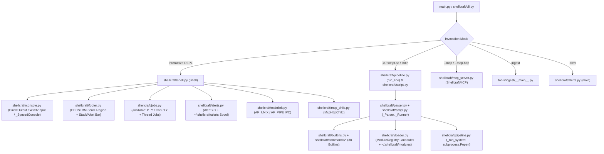

# ShellCraft — Full Code Analysis, Module Usage Audit & Windows 11 Plan (`WINDOWS_PLAN`)

> [!IMPORTANT]
> This analysis and engineering plan were derived **exclusively from source code** (`shellcraft/`, `shellcraft/commands/`, `core/`, `modules/`, `tools/`, `templates/`, `tests/`, `pyproject.toml`, `requirements.txt`, `main.py`) without reading any `.md` files.

---

## 1. Full Project Architecture Analysis (Code-Only)

ShellCraft (`v0.2.0`, Python `>=3.11`) is a hybrid **interactive cross-platform shell + Bash/Python scripting engine + Model Context Protocol (MCP) server + script-to-tool ingestion pipeline**.



### 1.1 Subsystem Breakdown

1. **Entry & Bootstrap (`main.py`, `shellcraft/cli.py`, `shellcraft/stdio.py`, `shellcraft/startup.py`)**
   - `utf8_stdio()` reconfigures non-console `sys.stdout`/`sys.stderr` streams to UTF-8 when `PYTHONIOENCODING` is unset so redirected/piped Unicode output (`├──`, `╭─`, `✗`) does not crash on Windows `cp1252`.
   - `cli.main()` loads `config.json` (`shellcraft/config.py`), applies persisted settings and secrets (`shellcraft/settings.py`), loads modules (`shellcraft/loader.py`), and dispatches to MCP server mode, one-shot `-c`/file/piped script execution, or interactive `Shell`.
   - `startup.py` executes `~/.shellcraft/startup/*.{py,sc}`, `~/.shellcraft/rc.sc`, and opt-in per-directory `.shellcraft.sc` files (tracked by SHA-256 hash in `trusted_workspaces` inside `config.json`).

2. **Console, TUI, Pager & Footer (`shellcraft/console.py`, `shellcraft/shell.py`, `shellcraft/footer.py`, `shellcraft/output.py`, `shellcraft/themes.py`)**
   - On Windows (`sys.platform == "win32"`), `create_prompt_toolkit_console()` bypasses `sys.stdin`/`sys.stdout` and opens `CONIN$` and `CONOUT$` directly via `os.open("CONIN$", ...)` and `open("CONOUT$", "w", encoding="utf-8")`.
   - `DirectOutput` subclasses `prompt_toolkit.output.vt100.Vt100_Output`, toggling `CONOUT$` between `FLUSH_OUTPUT_MODE` (`0x0005`, wrap disabled during prompt rendering) and `RESTING_OUTPUT_MODE` (`0x0007`, wrap enabled, `DISABLE_NEWLINE_AUTO_RETURN` cleared).
   - `Footer` uses VT100 `DECSTBM` (`\x1b[1;{region}r`) scroll margins to reserve the bottom $N$ rows of the terminal for a live status stack (alerts, `main`, and subshells), both at the `prompt_toolkit` prompt and while attached to a child PTY/ConPTY subshell.
   - `output.py` implements an in-process full-screen `prompt_toolkit` `Application` pager (`page()`) with regex search, horizontal/vertical scrolling, mouse scrollbar, and Rich ANSI rendering (`show()`).

3. **Parser, Scripting Engine & Streams (`shellcraft/parser.py`, `shellcraft/script.py`, `shellcraft/arith.py`, `shellcraft/histexpand.py`, `shellcraft/pipeline.py`, `shellcraft/streams.py`)**
   - Supports dual syntax: POSIX/Bash (`for ...; do ...; done`, `if ...; then ...; fi`, `while`, `until`, `case`, `select`, `name() { ... }`, `$((...))`, `$(...)`, `{a,b}`, `{1..5}`) and Pythonic mode (`for x in ... { ... }`, `if (expr) { ... }` evaluated via AST vetting in `script.py`).
   - `streams.py` provides cooperative pipeline streaming (`Lines`) with thread-local cancellation (`_CancelScope`) and subprocess tracking (`watching()`) so `Ctrl-C`, `head`, or `jobs -k` stops upstream producers immediately.

4. **Subshells & Background Jobs (`shellcraft/jobs.py`)**
   - Two job types:
     - `kind="command"`: runs ShellCraft pipelines/builtins/modules in a daemon thread with `streams.Cancel()` and a cloned `ShellContext`.
     - `kind="program"`: spawns external interactive programs (`sub bash`, `sub pwsh`, `sub vim`, `sub sc`) on a pseudo-terminal (`pty.openpty()` on POSIX; `winpty.PtyProcess` via `pywinpty` on Windows) and feeds output through a `pyte` terminal emulator (`_Screen` + `ByteStream`) with alternate-screen (`?1049h`/`?1049l`) and 2,000-line scrollback support.

5. **Alerts, Clipboard & Inter-Shell IPC (`shellcraft/alerts.py`, `shellcraft/mainlink.py`, `core/alerts.py`)**
   - `AlertBus` manages severity-ordered (`critical`, `warning`, `info`), auto-expiring alerts and watches `~/.shellcraft/alerts/*.json` every 250ms.
   - Generates a PATH shim (`~/.shellcraft/bin/alert` or `alert.cmd` on Windows) so child programs inside `sub` can post alerts back to the main shell.
   - `MainLink` opens an authenticated local IPC channel (`AF_UNIX` socket on POSIX, `AF_PIPE` named pipe on Windows via `multiprocessing.connection`) so nested `sub sc` (`--lite`) instances share the main shell's `clip` register (`$CLIP`).

6. **Builtins & Portable Unix Commands (`shellcraft/builtins.py`, `shellcraft/commands/*`)**
   - 38 builtins across `shellcraft/builtins.py` (`help`, `man`, `modules`, `reload`, `ingest`, `settings`, `theme`, `prompt`, `alias`, `unalias`, `history`, `record`, `cd`, `pwd`, `clear`, `exit`, `quit`, `sub`, `jobs`, `alert`, `clip`, `mcp`, `source`, `.`, `read`, `eval`, `less`) and `shellcraft/commands/` (`ls`, `mkdir`, `cp`, `mv`, `rm`, `find`, `tree`, `touch`, `du`, `echo`, `cat`, `grep`, `yes`, `head`, `tail`, `wc`, `sort`, `uniq`, `tee`, `cut`, `tr`, `diff`, `jq`, `date`, `which`, `env`, `printf`, `seq`, `xargs`, `basename`, `dirname`, `realpath`, `stat`, `whoami`, `hostname`, `uname`, `sleep`, `time`, `type`, `export`, `unset`, `declare`, `shift`, `local`, `test`, `[`, `[[`, `true`, `false`).

7. **MCP Server & Child Manager (`shellcraft/mcp_server.py`, `shellcraft/mcp_child.py`, `shellcraft/params.py`)**
   - Exposes every module (`modules/*.py` + `.skill`) as a typed MCP tool, plus `shellcraft_pipeline` (sandboxed: read-only builtins only, no file redirects, no OS commands, no stateful builtins, no env variable expansion) and `send_tui_alert`.
   - Runs over `stdio` (`--mcp`) or loopback Streamable HTTP (`--mcp-http` / `mcp start` via `uvicorn` + `starlette` with Bearer token auth and Origin validation).

---

## 2. Python Module Usage vs. Windows 11 Knowledge

### 2.1 Third-Party Modules

| Module | Declared In | Where Used | Code Usage vs. Windows 11 Behavior |
| :--- | :--- | :--- | :--- |
| **`prompt_toolkit`** (`>=3.0.43`) | `pyproject.toml`, `requirements.txt` | `console.py`, `shell.py`, `output.py`, `ask.py`, `completer.py`, `highlight.py`, `themes.py` | **Heavy internal hooking in `console.py`**: subclasses `_Win32InputBase`, `Vt100_Output`, monkeypatches `.handle` on `ConsoleInputReader`, `Vt100ConsoleInputReader`, `raw_mode`, `cooked_mode`, and closes `_fdcon`. **Critical Windows 11 conflict** between `WT_SESSION` (`legacy-keys` forcing `ConsoleInputReader`) and VT SGR mouse reporting (`\x1b[?1006h`) in `DirectOutput`. |
| **`rich`** (`>=13.7`) | `pyproject.toml`, `requirements.txt` | `console.py`, `output.py`, `banner.py`, `themes.py`, `builtins.py`, `commands/*`, `tools/ingest/*` | `_SyncedConsole` subclasses `rich.console.Console` with `legacy_windows=False, color_system="truecolor", force_terminal=True` on `CONOUT$`. Works well on Windows 11 ConPTY, except where `Footer.size()` and `DirectOutput._size()` disagree on terminal width by 1 column. |
| **`pywinpty`** (`>=2.0`, imported as `winpty`) | `pyproject.toml` (`sys_platform == 'win32'`), `requirements.txt` | `jobs.py`, `banner.py` | Used for `sub` pseudo-terminals on Windows via `PtyProcess.spawn([exe, *argv[1:]], cwd=..., env=..., dimensions=(rows, cols))`. Has lifecycle, `EOFError`/`OsError` read handling, process-tree termination, and `PATHEXT` resolution gaps on Windows 11. |
| **`pyte`** (`>=0.8.2`) | `pyproject.toml`, `requirements.txt` | `jobs.py`, `banner.py` | Emulates subshell screen (`pyte.HistoryScreen` + `pyte.ByteStream`). Pure Python; works identically on Windows, except `pywinpty` returns `str` which `_read_program` encodes to `utf-8` and `_windows_terminal.write` decodes per-chunk. |
| **`keyring`** (`>=25.0`) | `pyproject.toml`, `requirements.txt` | `settings.py`, `banner.py` | Uses Windows Credential Manager (`WinVaultKeyring`) on Windows 11 out-of-the-box. **However**, `tools/ingest/ai.py` bypasses `settings.load_secret()` and reads `"keychain"` literally from `config.json`! |
| **`mcp`** (`>=1.0`), **`uvicorn`**, **`starlette`**, **`anyio`** | `pyproject.toml`, `requirements.txt` | `mcp_server.py`, `mcp_child.py` | Used for stdio and Streamable HTTP MCP server. On Windows, `mcp.server.stdio.stdio_server()` and `uvicorn.Server` run under `anyio.run()` (which defaults to `asyncio` `ProactorEventLoop` on Windows 11). `mcp_child.py` parent-death watcher has a 64-bit `ctypes` `HANDLE` bug. |
| **`requests`** (`>=2.31`) | `pyproject.toml`, `requirements.txt` | `modules/myip.py`, `tools/ingest/ai.py` | Synchronous HTTPS calls. Note: `fetch.py`, `ip2geo.py`, `queryCert.py`, `queryDns.py` use `urllib.request` instead of `requests`. |
| **`censys-platform`** (`>=0.1`) | `pyproject.toml` (optional `[censys]`) | `modules/queryCensys.py` | Optional SDK; lazy-imported inside `_client()`. |

### 2.2 Standard Library Modules on Windows 11

| Module | Where Used | Windows 11 Specifics & Discrepancies |
| :--- | :--- | :--- |
| **`ctypes` / `ctypes.wintypes` / `msvcrt`** | `console.py`, `stdio.py`, `diagnostics.py`, `jobs.py`, `mcp_child.py`, `tools/winconsole_probe.py` | `console.py` properly defines `argtypes`/`restype` on its cached `_kernel32()`. **However**, `mcp_child.py` uses `ctypes.windll.kernel32` without `argtypes`/`restype` (64-bit `HANDLE` truncation / `0xFFFFFFFF` `OverflowError`), and `jobs.py:_windows_terminal` creates a fresh `ctypes.WinDLL("kernel32")` without `argtypes`/`restype`. |
| **`subprocess`** | `pipeline.py`, `jobs.py`, `mcp_child.py`, `builtins.py` | `pipeline.py` uses `cmd /d /u /c` for missing executables (`dir`, `mklink`), which introduces **cmd.exe metacharacter injection** and mangles binary streams. `mcp_child.py` uses `CREATE_NEW_PROCESS_GROUP` (`0x00000200`) without `CREATE_NO_WINDOW`. |
| **`multiprocessing.connection`** | `mainlink.py` | Uses `AF_PIPE` (`\\.\pipe\pyc-...`) on Windows. Fast and native on Windows 11. |
| **`os` / `pathlib` / `shutil` / `stat`** | Across all modules | `os.replace()` used in `alerts.py`, `config.py`, `aliases.py` without retry on Windows `PermissionError` (`WinError 5` / `WinError 32` sharing violations). `os.access(p, os.X_OK)` in `cond.py` is always `True` for any existing file/dir on Windows. `Path.expanduser("~user")` fails or behaves differently on Windows. |
| **`glob` / `fnmatch`** | `pipeline.py`, `script.py`, `commands/files.py`, `commands/cond.py` | `fnmatch.fnmatchcase` is used for `find -path`, `case`, `[[ == ]]`, causing path-separator (`\` vs `/`) mismatches on Windows 11. |

---

## 3. Detailed Windows 11 Bugs, Architectural Gaps & Edge Cases

### 3.1 [CRITICAL] Windows 11 `WT_SESSION` / DefTerm Mouse & Input Mode Conflict
- **Locations**: [`console.py:53-62`](file:///home/faru/Documents/local/shellcraft/shellcraft/console.py#L53-L62), [`console.py:163-180`](file:///home/faru/Documents/local/shellcraft/shellcraft/console.py#L163-L180), [`shell.py:456-484`](file:///home/faru/Documents/local/shellcraft/shellcraft/shell.py#L456-L484)
- **What the code does**:
  1. `console_mode()` checks `if os.environ.get("WT_SESSION"): return "legacy-keys"`.
  2. In `legacy-keys` mode, `_console_input()` sets `vt_keys=False`, selecting `prompt_toolkit.input.win32.ConsoleInputReader` (which reads `KEY_EVENT` and `MOUSE_EVENT` structs via `ReadConsoleInputW` with `ENABLE_VIRTUAL_TERMINAL_INPUT` **disabled**).
  3. Meanwhile, `DirectOutput.enable_mouse_support()` calls `super().enable_mouse_support()` (which writes `\x1b[?1000h\x1b[?1003h\x1b[?1006h` to `CONOUT$`) **AND** sets `ENABLE_MOUSE_INPUT` on `CONIN$`.
- **Why this breaks on Windows 11**:
  1. **Windows 11 Default Terminal (DefTerm)**: On Windows 11 22H2+, Windows Terminal (`OpenConsole.exe` + `ConPTY`) is the default terminal host. When a process is launched via DefTerm handoff (e.g., launching `python.exe` or `shellcraft.exe` from Explorer/Run), `WT_SESSION` is **not** always inherited, whereas launching a tab inside Windows Terminal **does** set `WT_SESSION`. Thus two identical Windows Terminal windows can run in completely different input modes (`direct` vs `legacy-keys`)!
  2. **SGR Mouse Escape Corruption under `legacy-keys`**: When `\x1b[?1000h\x1b[?1006h` is sent to Windows Terminal (`CONOUT$`), ConPTY switches mouse forwarding to **VT SGR mouse escape sequences** (`\x1b[<0;x;yM`). When `ENABLE_VIRTUAL_TERMINAL_INPUT` is off (`legacy-keys` / `ConsoleInputReader`), `ConsoleInputReader` does **not** run `Vt100Parser`! Instead:
     - Either ConPTY injects `\x1b[<...` as individual `KEY_EVENT` characters into `ReadConsoleInputW`, which `ConsoleInputReader` treats as literal `[<0;12;24M` keystrokes typed into the prompt or `Escape` followed by garbage!
     - Or if `MOUSE_EVENT_RECORD` structs are delivered, `ConsoleInputReader` yields `Keys.WindowsMouseEvent` with **buffer-relative** coordinates (`dwMousePosition.Y` includes scrollback offset `srWindow.Top` in conhost, though `ConsoleInputReader` adjusts some, `shell.py:_footer_mouse` passes `event.data` straight into `footer.parse_mouse()`, which adds `+1` to `y` without subtracting `srWindow.Top`!).
  3. **Fix**:
     - Stop forcing `legacy-keys` when `WT_SESSION` is set, OR if `Vt100ConsoleInputReader` (`ENABLE_VIRTUAL_TERMINAL_INPUT`) is used on Windows 11, fix the root cause of why `WT_SESSION` was switched to `legacy-keys`: in `prompt_toolkit`, `Vt100ConsoleInputReader` ignores `MOUSE_EVENT_RECORD` structs from `ReadConsoleInputW` and only parses VT sequences, which works **only** when `\x1b[?1000h\x1b[?1006h` is emitted to `CONOUT$` AND `ENABLE_VIRTUAL_TERMINAL_INPUT` is set on `CONIN$`.
     - If `ConsoleInputReader` (`legacy-keys`) *is* used, `DirectOutput.enable_mouse_support()` must **not** emit `\x1b[?1000h\x1b[?1006h` if ConPTY translates that into raw VT characters, or `parse_mouse` must normalize `srWindow.Top` buffer coordinates.

### 3.2 [CRITICAL] 64-Bit Windows `HANDLE` Truncation & `OverflowError` in `mcp_child.py` and `jobs.py`
- **Locations**:
  - [`mcp_child.py:150-163`](file:///home/faru/Documents/local/shellcraft/shellcraft/mcp_child.py#L150-L163) (`_watch_parent`)
  - [`jobs.py:961-991`](file:///home/faru/Documents/local/shellcraft/shellcraft/jobs.py#L961-L991) (`_windows_terminal`)
- **What the code does**:
  In `mcp_child.py`:
  ```python
  handle = ctypes.windll.kernel32.OpenProcess(0x00100000, False, pid)  # SYNCHRONIZE
  if not handle:
      return
  ctypes.windll.kernel32.WaitForSingleObject(handle, 0xFFFFFFFF)
  ```
- **Why this breaks on 64-bit Windows 11**:
  1. `ctypes.windll.kernel32` functions default to `restype = c_int` (32-bit signed) and `argtypes = None` (default C integer promotion, 32-bit signed `c_int` for Python `int`).
  2. Passing `0xFFFFFFFF` (`INFINITE`, `4294967295`) without `argtypes = [wintypes.HANDLE, wintypes.DWORD]` raises **`OverflowError: int too long to convert`** in 64-bit Python on Windows because `0xFFFFFFFF` exceeds `INT32_MAX` (`0x7FFFFFFF`)! Because `_watch_parent` runs in a daemon thread (`threading.Thread(target=watch, daemon=True)`), this `OverflowError` crashes the parent-watcher thread silently on startup, meaning **the MCP HTTP child process NEVER exits when the parent shell crashes or is killed on Windows 11!**
  3. Furthermore, `OpenProcess` returns a 64-bit `HANDLE` (`void*`), which gets truncated to 32-bit signed `c_int` without `restype = wintypes.HANDLE`, and `CloseHandle(handle)` is never called (handle leak).
  4. In `jobs.py:_windows_terminal()`, `k32 = ctypes.WinDLL("kernel32", use_last_error=True)` creates a new `WinDLL` instance without setting `argtypes`/`restype` on `WaitForSingleObject`, `ReadConsoleInputW`, `GetConsoleMode`, or `SetConsoleMode`.
- **Fix**: Centralize `kernel32` bindings in `shellcraft/console.py` (with explicit `wintypes.HANDLE`, `wintypes.DWORD`, `wintypes.BOOL` `argtypes`/`restype`, plus `OpenProcess` and `CloseHandle`) and reuse them in `mcp_child.py`, `jobs.py`, `stdio.py`, and `diagnostics.py`.

### 3.3 [CRITICAL] Subshell (`sub`) Console Input/Output Contention & Mouse/UTF-8 Bugs on Windows 11
- **Location**: [`jobs.py:951-1033`](file:///home/faru/Documents/local/shellcraft/shellcraft/jobs.py#L951-L1033) (`_windows_terminal`), [`jobs.py:553-702`](file:///home/faru/Documents/local/shellcraft/shellcraft/jobs.py#L553-L702) (`attach`)
- **Multiple bugs in `_windows_terminal()`**:
  1. **QuickEdit Mode blocks Mouse Wheel & Footer Clicks while attached to a Subshell**:
     - When `attach()` runs on Windows, `term.mouse(True)` writes `\x1b[?1000h\x1b[?1006h` to `CONOUT$`.
     - However, `_windows_terminal()`'s `set_raw()` (lines 994-996) only sets:
       `raw_mode = mode.value | enable_vt_input | enable_window_input` (`0x0200 | 0x0008`).
     - It **never** sets `ENABLE_MOUSE_INPUT` (`0x0010`), **never** sets `ENABLE_EXTENDED_FLAGS` (`0x0080`), and **never** clears `ENABLE_QUICK_EDIT_MODE` (`0x0040`)!
     - On Windows 11, if `ENABLE_QUICK_EDIT_MODE` remains active on `CONIN$`, left-clicks on the footer bar (to switch subshells, fold the stack, or dismiss alerts) are intercepted by Windows Console/Terminal selection mode instead of reaching the subshell attach loop!
  2. **Console Mode Clobbering on Detach**:
     - `_windows_terminal()` saves `mode` when `Terminal` is constructed and restores `k32.SetConsoleMode(conin, mode.value)` in `close()`.
     - Also, `reader()` skips `KEY_EVENT` records when `not key.bKeyDown`, and only reads `key.uChar.UnicodeChar` or `win_key(char, key.wVirtualKeyCode)`. When `MOUSE_EVENT` (`EventType == 0x0002`) records arrive in `ReadConsoleInputW` (which happens on Windows when `ENABLE_MOUSE_INPUT` is set or in conhost), `rec.EventType == 0x0001` ignores `MOUSE_EVENT` completely!
  3. **Split Multibyte UTF-8 Corruption in `_windows_terminal.write()`**:
     - Line 1000: `conout.write(data.decode("utf-8", errors="replace"))`.
     - If `data` (a `bytes` chunk from `job.sink` or `footer.clamp_margins`) splits a 3-byte or 4-byte UTF-8 sequence across two writes, `.decode("utf-8", errors="replace")` replaces both halves with `` (`U+FFFD`). It should use `codecs.getincrementaldecoder("utf-8")("replace")`.
  4. **Terminal Size Mismatch in `start_program()`**:
     - Line 400: `rows, cols = size or _terminal_size()`.
     - `_terminal_size(fd: int = 1)` calls `os.get_terminal_size(1)`. On Windows, when `DirectConsole` is used or `stdout` is wrapped, `fd=1` may not reflect `CONOUT$` or the `columns - 1` adjustment!
  5. **`pywinpty` (`PtyProcess`) Edge Cases on Windows 11**:
     - In `jobs.py:397`: `exe = shutil.which(argv[0]) if not os.path.dirname(argv[0]) else argv[0]`. On Windows, if a user runs `sub .\script.bat` or `sub bin/mytool`, `os.path.dirname(argv[0])` is non-empty (`"."` or `"bin"`), so `shutil.which()` is skipped! Unlike POSIX, `shutil.which(argv[0])` on Windows resolves `PATHEXT` (`.exe`, `.cmd`, `.bat`, `.com`) even when `argv[0]` has a relative directory path! Skipping `shutil.which` breaks relative-path executables without an extension on Windows.
     - In `jobs.py:459-467` (`_read_program`): on Windows 11 ConPTY (`pywinpty`), `PtyProcess.read(4096)` can raise `OsError` / ` winpty.WinptyError` (e.g. pipe broken when child exits abruptly) in addition to `EOFError` and `OSError`. Catching `(EOFError, OSError)` handles `OSError`, which is good, but when `pty_proc.read()` returns `""`, the loop `continue`s without sleeping if `pty_proc.isalive()` is still briefly `True`, causing a 100% CPU spin until `isalive()` flips to `False`!

### 3.4 [HIGH] Off-By-One Terminal Width in `Footer.size()` Causes Line-Wrap Corruption on Windows Console
- **Locations**: [`footer.py:59-66`](file:///home/faru/Documents/local/shellcraft/shellcraft/footer.py#L59-L66) vs. [`console.py:140-145`](file:///home/faru/Documents/local/shellcraft/shellcraft/console.py#L140-L145)
- **What the code does**:
  - `console.window_size(info)` intentionally returns `columns = min(info.dwSize.X - 1, window.Right - window.Left)` (1 column narrower than the console buffer) because writing to the last column of the bottom-most row in a Windows console with `ENABLE_WRAP_AT_EOL_OUTPUT` (`RESTING_OUTPUT_MODE`) triggers an automatic scroll/line-wrap!
  - However, `Footer.size()` calls `os.get_terminal_size(self.ui.console.file.fileno())`, which returns the **full** `columns` (not `columns - 1`)!
  - `Footer.render(cols)` pads every footer row to `cols` characters (`panel_lines(..., width=cols)`) and `Footer.paint()` writes that full-width line to the very last row (`\x1b[{rows};1H\x1b[2K{line}`) while `CONOUT$` is in `RESTING_OUTPUT_MODE` (where `ENABLE_WRAP_AT_EOL_OUTPUT` is ON)!
- **Impact on Windows 11**:
  - Writing the `cols`-th character on the bottom row of `CONOUT$` in `RESTING_OUTPUT_MODE` can scroll the entire screen or wrap the cursor onto a blank line below the footer, shifting the prompt and scroll region up by 1 line on every repaint!

### 3.5 [HIGH] `pipeline.py` Windows System Command Execution (`cmd /d /u /c`, Binary Corruption, Argument Quoting)
- **Locations**: [`pipeline.py:553-684`](file:///home/faru/Documents/local/shellcraft/shellcraft/pipeline.py#L553-L684)
- **Issues**:
  1. **Unconditional `cmd /d /u /c` Fallback & Command Injection (`_resolve_system`, line 559)**:
     - Whenever `shutil.which(cmd.name)` returns `None` on Windows, `_resolve_system()` rewrites the command to `["cmd", "/d", "/u", "/c", cmd.name, *cmd.args]` instead of checking whether `cmd.name` is actually a `cmd.exe` internal command (`dir`, `mklink`, `assoc`, `ftype`, `ver`, `vol`, `type`, `copy`, `ren`, `del`, `rd`, `md`, `cls`, `set`, etc.).
     - Worse: when `subprocess.Popen(["cmd", "/d", "/u", "/c", ...])` runs on Windows, Python joins the list using `subprocess.list2cmdline` (CRT rules), which `cmd.exe /c` then **re-parses** with `cmd.exe` metacharacter rules (`&`, `|`, `>`, `<`, `^`, `%VAR%`, `!VAR!`)! And if a user types a typo for a nonexistent command on Windows, instead of a fast internal `command not found`, it spawns `cmd.exe` on every typo!
  2. **UTF-16 Heuristic False Positives (`_decode`, lines 562-571)**:
     - `_decode(raw, utf16=True)` checks `if utf16 and len(raw) >= 2 and len(raw) % 2 == 0 and raw[1::2].count(0) > len(raw) // 8: text = raw.decode("utf-16-le", errors="replace")`.
     - Even when a real `.exe` is spawned via `cmd /d /u /c` (because it wasn't found by `shutil.which`), `utf16` is `True`.
  3. **Text-Only Pipe Assumption Between Two External OS Programs (`_run_system`)**:
     - Each pipeline stage converts `Popen` output to a Python `str` (`_decode(raw)`), normalizing `\r\n` to `\n`, and re-encodes to UTF-8 `stdin.encode("utf-8")` for the next stage. That is by design for ShellCraft's text streams, but worth documenting when piping Windows tools.
  4. **Process Tree Orphaning on `proc.kill()` (`streams.py:130`, `pipeline.py:598`)**:
     - On Windows, when a command is run via `cmd /d /u /c ...` or spawns child processes (e.g., a `.bat`/`.cmd` wrapper or `npm.cmd`, `poetry.exe`), `proc.kill()` (`TerminateProcess`) only kills the top-level `cmd.exe` or wrapper process, leaving grandchild processes running and holding `stdout`/`stderr` pipe handles open! Because the grandchild still holds the write end of `stdout`/`stderr`, `proc.communicate()` in `pipeline.py:595` **blocks forever** after `Ctrl-C` on Windows!

### 3.6 [HIGH] Atomic File Replacement (`os.replace`) Sharing Violations on Windows 11 NTFS
- **Locations**:
  - [`alerts.py:349`](file:///home/faru/Documents/local/shellcraft/shellcraft/alerts.py#L349) (`_spool`: `os.replace(tmp, final)`)
  - [`alerts.py:213-224`](file:///home/faru/Documents/local/shellcraft/shellcraft/alerts.py#L213-L224) (`drain`: `path.read_text()` + `path.unlink()`)
  - [`config.py:119`](file:///home/faru/Documents/local/shellcraft/shellcraft/config.py#L119) (`save_config`: `os.replace(tmp, path)`)
  - [`aliases.py:140`](file:///home/faru/Documents/local/shellcraft/shellcraft/aliases.py#L140) (`_rewrite`: `os.replace(tmp, target)`)
- **Why this fails on Windows 11**:
  - Unlike POSIX rename, Windows `MoveFileExW(..., MOVEFILE_REPLACE_EXISTING)` (called by `os.replace`) fails with `PermissionError: [WinError 5] Access is denied` or `[WinError 32] The process cannot access the file because it is being used by another process` if **any** process or thread has an open handle to the destination or source file (including `AlertBus._poll` scanning `~/.shellcraft/alerts`, Windows Defender real-time antivirus scanning newly closed `.tmp` files, or Windows Search Indexer).
  - In `config.py:119` and `aliases.py:140`, `tmp` has a fixed name (`config.json.tmp`, `rc.sc.tmp`), and `os.replace(tmp, path)` has no retry loop. If `save_config` or `AlertBus` hits a transient sharing violation on Windows 11, an uncaught `PermissionError` is raised!

### 3.7 [HIGH] `tools/ingest/ai.py` Keychain Secret Bug (Especially Prominent on Windows 11)
- **Location**: [`tools/ingest/ai.py:54-60`](file:///home/faru/Documents/local/shellcraft/tools/ingest/ai.py#L54-L60)
- **What the code does**:
  ```python
  def stored_key(provider: Provider) -> str:
      if value := os.environ.get(provider.env, "").strip():
          return value
      stored = (load_config().get("env") or {}).get(provider.env)
      return stored.strip() if isinstance(stored, str) else ""
  ```
- **Why this breaks on Windows 11**:
  - On Windows 11, `keyring` uses Windows Credential Manager (`WinVaultKeyring`), which is always available without extra daemon setup.
  - When a user saves `ANTHROPIC_API_KEY` or `OPENAI_API_KEY` via `settings ANTHROPIC_API_KEY`, [`settings.py:306`](file:///home/faru/Documents/local/shellcraft/shellcraft/settings.py#L306) stores the secret in Windows Credential Manager and writes `"keychain"` (`_KEYCHAIN`) into `config.json["env"]["ANTHROPIC_API_KEY"]`.
  - When `python -m tools.ingest` or `shellcraft ingest` runs standalone, `settings.apply_env()` has not populated `os.environ` for `ANTHROPIC_API_KEY`/`OPENAI_API_KEY` unless `cli.main()` ran first, OR if `stored_key()` falls back to `load_config()`, it returns the literal string `"keychain"` instead of calling `settings.load_secret(provider.env, stored)`!

### 3.8 [MEDIUM] Path, Globbing, Case-Sensitivity & File Test Issues Across Commands & Parser
1. **`cond.py` (`test -x` / `[ -x FILE ]`) Always Returns `True` on Windows**:
   - [`shellcraft/commands/cond.py:21`](file:///home/faru/Documents/local/shellcraft/shellcraft/commands/cond.py#L21): `"-x": lambda p: os.access(p, os.X_OK)`.
   - In Python on Windows, `os.access(path, os.X_OK)` is identical to `os.access(path, os.F_OK)` — it returns `True` for **every existing file and directory** (even `README.txt` or a folder)! Meanwhile [`shellcraft/commands/files.py:39-42`](file:///home/faru/Documents/local/shellcraft/shellcraft/commands/files.py#L39-L42) implements `_is_executable()` properly on Windows by checking `path.suffix.lower() in {".exe", ".bat", ".cmd", ".ps1", ".com"}` (or `PATHEXT`). `cond.py` should use the same logic!
2. **`find -path` / `-ipath` Backslash vs. Forward-Slash Mismatch on Windows**:
   - [`shellcraft/commands/files.py:414`](file:///home/faru/Documents/local/shellcraft/shellcraft/commands/files.py#L414): `_walk` builds `shown` using `os.path.join(shown, child.name)`, which uses `\` on Windows (`.\shellcraft\cli.py`).
   - [`shellcraft/commands/files.py:536-539`](file:///home/faru/Documents/local/shellcraft/shellcraft/commands/files.py#L536-L539): `-path` and `-ipath` match `shown` against `value` using `fnmatch.fnmatchcase(shown, value)`. A user (or script) running `find . -path "*/tests/*"` (as shown in `find`'s own docstring on line 464!) will get **0 matches on Windows** because `shown` contains `\` instead of `/`!
3. **`dirname` and `basename` Drive-Letter & UNC Path Edge Cases on Windows**:
   - [`shellcraft/commands/misc.py:354`](file:///home/faru/Documents/local/shellcraft/shellcraft/commands/misc.py#L354):
     `os.path.dirname(p.rstrip("/\\")) or ("/" if p.startswith("/") else ".")`
     On Windows, for `dirname C:\` or `dirname C:\foo`:
     - `C:\`.rstrip("/\\") becomes `"C:"`. `os.path.dirname("C:")` is `""`, so `dirname C:\` returns `"."` instead of `"C:\\"`!
4. **`diff -r` Case-Insensitive Directory Comparison on Windows**:
   - [`shellcraft/commands/diff.py:231-236`](file:///home/faru/Documents/local/shellcraft/shellcraft/commands/diff.py#L231-L236): `a_names = {p.name: p for p in left.iterdir()}`. On Windows NTFS (case-insensitive, case-preserving), if `dir1` has `Config.json` and `dir2` has `config.json`, `diff -r dir1 dir2` reports `Only in dir1: Config.json` and `Only in dir2: config.json` instead of comparing them.
5. **`du` Hardlink Deduplication on Windows (`st_ino == 0` / `st_nlink`)**:
   - [`shellcraft/commands/files.py:787-790`](file:///home/faru/Documents/local/shellcraft/shellcraft/commands/files.py#L787-L790): works on Python 3.11+ on NTFS where `os.lstat()` populates `st_ino` and `st_nlink`, though on FAT32/exFAT/network shares where `st_ino == 0` and `st_nlink > 1`, `(st.st_dev, 0)` could falsely deduplicate unrelated files if `st.st_ino != 0` is not checked (`if st.st_nlink > 1 and st.st_ino:`).
6. **`shutil.rmtree` on Read-Only Files (`.git/objects`) in `rm -r` on Windows**:
   - [`shellcraft/commands/files.py:390`](file:///home/faru/Documents/local/shellcraft/shellcraft/commands/files.py#L390): `shutil.rmtree(path)`.
   - On Windows 11, files with the `FILE_ATTRIBUTE_READONLY` bit set (most notably `.git/objects/pack/*` created by Git for Windows!) cause `shutil.rmtree(path)` to fail with `PermissionError: [WinError 5] Access is denied` even with `-f`! Adding an `onexc` / `onerror` handler that clears `stat.S_IWRITE` when `force=True` (or always in `rm -r`) is standard practice on Windows.
7. **Tilde Expansion `~/...` with Backslashes on Windows**:
   - [`shellcraft/parser.py:254`](file:///home/faru/Documents/local/shellcraft/shellcraft/parser.py#L254) and [`shellcraft/script.py:1011`](file:///home/faru/Documents/local/shellcraft/shellcraft/script.py#L1011) and [`shellcraft/completer.py:209`](file:///home/faru/Documents/local/shellcraft/shellcraft/completer.py#L209):
     Checks `if word == "~" or word.startswith("~/"):` — on Windows, users often type `~\Documents` (or Tab-completion inserts `\` via `os.path.join`), which fails `word.startswith("~/")`!
8. **Backslash Escape vs. Windows Path Separator in `parser.py` & `completer.py`**:
   - In [`completer.py:194`](file:///home/faru/Documents/local/shellcraft/shellcraft/completer.py#L194), `os.path.join(dirname, entry)` uses `\` on Windows. If a user types `cd sub` and presses Tab twice (`sub\child`), `parser.py:265` treats unquoted `\t`, `\n`, `\\` inside words: in `parser.py:265`, `_ESCAPES` only escapes `\`, `"`, `'`, `$`, ` `, `\t`, and `\|`, `\;`, `\&`, `\>`, `\<`, keeping other `\x` as `\x`. However, a path like `C:\temp\new` has `\ ` if there's a space, or `C:\users\\` at the end of a directory where trailing `\` escapes the closing quote `"C:\Users\"`!
   - Specifically, in [`completer.py:202`](file:///home/faru/Documents/local/shellcraft/shellcraft/completer.py#L202), directory completions append `"/"` (`shown += "/"`), while `os.path.join(dirname, entry)` on line 194 inserts `\` on Windows, producing mixed-slash completions like `foo\bar/`.

### 3.9 [MEDIUM] `mcp_child.py` & `alerts.py` Windows Process / Shim Details
1. **Console Window Flash / Signal Handling in `mcp_child.py`**:
   - [`mcp_child.py:67`](file:///home/faru/Documents/local/shellcraft/shellcraft/mcp_child.py#L67): `creationflags = getattr(subprocess, "CREATE_NEW_PROCESS_GROUP", 0)` when `sys.platform == "win32"`.
   - If ShellCraft was launched from a GUI runner or `pythonw.exe`, spawning `sys.executable` without `subprocess.CREATE_NO_WINDOW` (`0x08000000`) can flash a console window.
   - In [`mcp_child.py:98-107`](file:///home/faru/Documents/local/shellcraft/shellcraft/mcp_child.py#L98-L107): `self.process.terminate()` on Windows calls `TerminateProcess(handle, 1)` immediately (hard kill, not graceful shutdown), so `uvicorn`'s lifespan cleanup doesn't run on `mcp stop`.
2. **`modules/fetch.py` Uninterruptible `time.sleep` During Retries**:
   - [`modules/fetch.py:134,139,144`](file:///home/faru/Documents/local/shellcraft/modules/fetch.py#L134): calls `time.sleep(_backoff(...))` instead of `from shellcraft.modkit import sleep` (`streams.wait`). A retry backoff of up to 30s cannot be interrupted by `jobs -k` or pipeline cancellation, and on Windows `Ctrl-C` inside a worker thread does not interrupt `time.sleep`.

---

## 4. `WINDOWS_PLAN`: Phased Engineering Roadmap for Windows 11

### Phase 1: Console, ConPTY & Windows Terminal Input/Output Unification (P0 — Critical)

#### 1.1 Fix Windows Terminal (`WT_SESSION` / ConPTY) Input & Mouse Mode Architecture
- **File**: [`shellcraft/console.py`](file:///home/faru/Documents/local/shellcraft/shellcraft/console.py), [`shellcraft/footer.py`](file:///home/faru/Documents/local/shellcraft/shellcraft/footer.py), [`shellcraft/shell.py`](file:///home/faru/Documents/local/shellcraft/shellcraft/shell.py)
- **Changes**:
  1. **Unify VT Input & Mouse Handling on Windows 11**:
     - Understand why `WT_SESSION` was previously forced to `legacy-keys` in `console.py:59`: when `Vt100ConsoleInputReader` is used (`vt_keys=True`), `ENABLE_VIRTUAL_TERMINAL_INPUT` is turned on. In Windows Terminal / ConPTY, mouse events are delivered as **VT SGR escape sequences** (`\x1b[<...M`) over `CONIN$` **only when** `\x1b[?1000h\x1b[?1006h` is sent to `CONOUT$` AND `ENABLE_QUICK_EDIT_MODE` is off on `CONIN$`.
     - However, when `ConsoleInputReader` (`legacy-keys`, `vt_keys=False`) is used, `DirectOutput.enable_mouse_support()` was *still* calling `super().enable_mouse_support()` (which emits `\x1b[?1000h\x1b[?1003h\x1b[?1006h` to `CONOUT$`)! Under ConPTY, emitting `\x1b[?1000h` causes ConPTY to emit SGR mouse sequences into `CONIN$`, or under `legacy-keys` `ConsoleInputReader` receives `MOUSE_EVENT_RECORD` structs whose `dwMousePosition.Y` is **screen-buffer relative** (not viewport-relative!).
     - **Action**:
       - In `DirectOutput`: store `self.vt_keys: bool`. When `vt_keys=True` (default on Windows 11 `direct` mode), emit VT mouse sequences (`super().enable_mouse_support()`) and disable QuickEdit (`ENABLE_EXTENDED_FLAGS | (mode & ~ENABLE_QUICK_EDIT_MODE)`).
       - When `vt_keys=False` (`legacy-keys`), either:
         - Subtract `info.srWindow.Top` from `MOUSE_EVENT` row coordinates before passing to `footer.mouse()` so scrolled conhost buffers hit-test the footer rows accurately, **and** do not emit `\x1b[?1000h\x1b[?1006h` if `ConsoleInputReader` is reading `MOUSE_EVENT` records directly; OR
         - Use `direct` (`Vt100ConsoleInputReader`) on Windows 11 (`WT_SESSION`) and ensure `DirectOutput.enable_mouse_support()` sets `ENABLE_MOUSE_INPUT | ENABLE_EXTENDED_FLAGS` and clears `ENABLE_QUICK_EDIT_MODE` on `CONIN$` so ConPTY translates mouse clicks/wheel/hover into SGR `\x1b[<...` sequences that `Vt100ConsoleInputReader` parses natively into `Keys.Vt100MouseEvent`!
  2. **Fix `Footer.size()` Last-Column Auto-Wrap Bug**:
     - In [`shellcraft/footer.py:59-66`](file:///home/faru/Documents/local/shellcraft/shellcraft/footer.py#L59-L66):
       - On Windows (`sys.platform == "win32"`), `Footer.size()` must query `console.buffer_info(conout)` / `console.window_size(info)` (which caps width at `columns - 1` to avoid bottom-right corner auto-wrap in `RESTING_OUTPUT_MODE`), or wrap `Footer.paint()` in `FLUSH_OUTPUT_MODE` (where `ENABLE_WRAP_AT_EOL_OUTPUT` is off) so full-width footer lines never scroll the console buffer!

#### 1.2 Fix Subshell (`_windows_terminal` & `pywinpty`) on Windows 11
- **File**: [`shellcraft/jobs.py`](file:///home/faru/Documents/local/shellcraft/shellcraft/jobs.py)
- **Changes**:
  1. **Reuse `shellcraft.console._kernel32()` with Full `argtypes`/`restype`**:
     - Remove the untyped `k32 = ctypes.WinDLL("kernel32", use_last_error=True)` in `_windows_terminal()` and use properly typed `kernel32` functions from `shellcraft.console`.
  2. **Enable Mouse Input & Disable QuickEdit in `_windows_terminal()`**:
     - In `_windows_terminal()`'s `mouse(on: bool)` and `set_raw()`:
       - When `mouse(True)` is called (when `footer` is active or scrollback is available), set `ENABLE_MOUSE_INPUT | ENABLE_EXTENDED_FLAGS` and clear `ENABLE_QUICK_EDIT_MODE` on `conin` (in addition to writing `footer_mouse_bytes`), and restore the original `conin` mode on `mouse(False)` and `close()`.
  3. **Use an Incremental UTF-8 Decoder in `_windows_terminal.write()`**:
     - Replace `conout.write(data.decode("utf-8", errors="replace"))` with `codecs.getincrementaldecoder("utf-8")("replace").decode(data)` so multibyte UTF-8 characters (`●`, `○`, `✖`, `─`, emoji) split across PTY chunks are never corrupted into `U+FFFD`.
  4. **Fix `PATHEXT` Resolution for Relative Paths in `JobTable.start_program()`**:
     - In [`jobs.py:397`](file:///home/faru/Documents/local/shellcraft/shellcraft/jobs.py#L397): on Windows (`sys.platform == "win32"`), always call `shutil.which(argv[0], path=...)` even when `os.path.dirname(argv[0])` is non-empty so `sub .\script` or `sub .\mytool` resolves `.exe`/`.cmd`/`.bat`.
  5. **Prevent Busy-Wait Spin in `_read_program()`**:
     - In [`jobs.py:459-467`](file:///home/faru/Documents/local/shellcraft/shellcraft/jobs.py#L459-L467): when `pty_proc.read(4096)` returns `""` and `pty_proc.isalive()` is `True`, sleep briefly (`time.sleep(0.01)`) before looping so ConPTY empty reads do not burn 100% CPU.

---

### Phase 2: Win32 `ctypes` 64-Bit Safety & Process Lifecycle (P0 — Critical)

#### 2.1 Fix `_watch_parent` 64-Bit `HANDLE` & `INFINITE` `OverflowError`
- **File**: [`shellcraft/mcp_child.py:150-163`](file:///home/faru/Documents/local/shellcraft/shellcraft/mcp_child.py#L150-L163)
- **Changes**:
  ```python
  if sys.platform == "win32":
      import ctypes
      from ctypes import wintypes

      k32 = ctypes.WinDLL("kernel32", use_last_error=True)
      k32.OpenProcess.argtypes = [wintypes.DWORD, wintypes.BOOL, wintypes.DWORD]
      k32.OpenProcess.restype = wintypes.HANDLE
      k32.WaitForSingleObject.argtypes = [wintypes.HANDLE, wintypes.DWORD]
      k32.WaitForSingleObject.restype = wintypes.DWORD
      k32.CloseHandle.argtypes = [wintypes.HANDLE]
      k32.CloseHandle.restype = wintypes.BOOL

      handle = k32.OpenProcess(0x00100000, False, pid)  # SYNCHRONIZE
      if not handle:
          return
      try:
          k32.WaitForSingleObject(handle, 0xFFFFFFFF)
      finally:
          k32.CloseHandle(handle)
  ```
- **Why**: Eliminates the `OverflowError: int too long to convert` on `0xFFFFFFFF` and 64-bit `HANDLE` truncation on Windows 11, ensuring orphaned `mcp start` HTTP servers reliably self-terminate when the parent shell dies.

#### 2.2 Process-Tree Termination & Safe `cmd.exe` Builtin Handling in `pipeline.py` & `streams.py`
- **Files**: [`shellcraft/pipeline.py:553-605`](file:///home/faru/Documents/local/shellcraft/shellcraft/pipeline.py#L553-L605), [`shellcraft/streams.py:124-136`](file:///home/faru/Documents/local/shellcraft/shellcraft/streams.py#L124-L136)
- **Changes**:
  1. **Restrict `cmd /d /u /c` to Known `cmd.exe` Internal Commands**:
     - Define `_CMD_BUILTINS = frozenset({"assoc", "call", "cd", "chdir", "cls", "color", "copy", "date", "del", "dir", "echo", "erase", "ftype", "md", "mkdir", "mklink", "move", "path", "popd", "prompt", "pushd", "rd", "ren", "rename", "rmdir", "set", "start", "time", "title", "type", "ver", "verify", "vol"})`.
     - In `_resolve_system(cmd)`: if `shutil.which(cmd.name)` is `None`, only fall back to `["cmd", "/d", "/u", "/c", ...]` if `cmd.name.lower() in _CMD_BUILTINS` (or `.bat`/`.cmd` file). For unknown commands, raise `PipelineError(127, ..., f"{cmd.name}: command not found")` immediately without spawning `cmd.exe`!
  2. **Kill Process Tree on Windows Cancellation**:
     - When `streams.Cancel.cancel()` or `_run_system` kills a running `subprocess.Popen` on Windows, if the process has children (e.g., `cmd.exe` or `.bat`), `proc.kill()` leaves grandchild processes holding pipe handles open, deadlocking `proc.communicate()`.
     - Add a Windows helper `_kill_process_tree(proc)` (using a Win32 Job Object with `JOB_OBJECT_LIMIT_KILL_ON_JOB_CLOSE` or `taskkill /F /T /PID <pid>` fallback, and closing `proc.stdout`/`proc.stderr` pipes before `proc.wait(timeout=1.0)`).

---

### Phase 3: Filesystem, Atomic Writes, Keyring & Path Portability on Windows 11 (P1 — High)

#### 3.1 Resilient Atomic File Replacement on Windows (`os.replace` Retry Helper)
- **Files**: [`shellcraft/config.py`](file:///home/faru/Documents/local/shellcraft/shellcraft/config.py), [`shellcraft/alerts.py`](file:///home/faru/Documents/local/shellcraft/shellcraft/alerts.py), [`shellcraft/aliases.py`](file:///home/faru/Documents/local/shellcraft/shellcraft/aliases.py)
- **Changes**:
  - Create a shared `atomic_write_text(path: Path, content: str)` helper (e.g. in `shellcraft/config.py`) that:
    1. Uses a unique temp file name (`f".{path.name}.{os.getpid()}.{threading.get_ident()}.tmp"`) so concurrent threads/processes never collide on `config.json.tmp`.
    2. Retries `os.replace(tmp, path)` on `PermissionError` (up to 5 attempts with 10–50ms backoff on `sys.platform == "win32"`) to survive transient Windows Defender / Search Indexer / `AlertBus` file-lock races.
  - In `alerts.py:drain()`, if `path.read_text()` hits a transient `PermissionError`, skip deleting `path` on that tick so the next 250ms poll reads it instead of dropping the alert!

#### 3.2 Fix `tools/ingest/ai.py` Keychain Secret Lookup
- **File**: [`tools/ingest/ai.py:54-60`](file:///home/faru/Documents/local/shellcraft/tools/ingest/ai.py#L54-L60)
- **Changes**:
  - Update `stored_key(provider)` to resolve `"keychain"` entries via `shellcraft.settings.load_secret(provider.env, stored)` instead of returning the literal placeholder string `"keychain"` when `keyring` (Windows Credential Manager) is active.

#### 3.3 Fix Portable Commands & Shell Expansion for Windows Paths
- **Files**:
  - [`shellcraft/commands/cond.py:21`](file:///home/faru/Documents/local/shellcraft/shellcraft/commands/cond.py#L21): Replace `"-x": lambda p: os.access(p, os.X_OK)` on Windows with `PATHEXT` / executable suffix checking (matching `files.py:_is_executable`, plus directories for searchability if appropriate, or files with `.exe`, `.bat`, `.cmd`, `.ps1`, `.com` extensions).
  - [`shellcraft/commands/files.py:536-539`](file:///home/faru/Documents/local/shellcraft/shellcraft/commands/files.py#L536-L539): In `find`, normalize `shown.replace("\\", "/")` and `value.replace("\\", "/")` inside `-path` and `-ipath` checks so `find . -path "*/tests/*"` works identically on Windows and Linux.
  - [`shellcraft/commands/files.py:390`](file:///home/faru/Documents/local/shellcraft/shellcraft/commands/files.py#L390): In `rm`, pass an `onexc` handler to `shutil.rmtree` on Windows that clears `stat.S_IWRITE` (`os.chmod(func_path, stat.S_IWRITE)`) and retries `func(func_path)` so `rm -r` can delete repositories containing read-only `.git/objects/pack/*` files on Windows 11.
  - [`shellcraft/commands/misc.py:354`](file:///home/faru/Documents/local/shellcraft/shellcraft/commands/misc.py#L354): Fix `dirname` so Windows drive roots (`C:\`, `C:/`) and drive-qualified paths (`C:\foo`) return `C:\` rather than `.`.
  - [`shellcraft/commands/diff.py:230-236`](file:///home/faru/Documents/local/shellcraft/shellcraft/commands/diff.py#L230-L236): Respect `-i` (`opts.ignore_case`) when matching filenames across directories in `_diff_dirs()`.
  - [`shellcraft/parser.py:254`](file:///home/faru/Documents/local/shellcraft/shellcraft/parser.py#L254), [`shellcraft/script.py:1011`](file:///home/faru/Documents/local/shellcraft/shellcraft/script.py#L1011), [`shellcraft/completer.py:209`](file:///home/faru/Documents/local/shellcraft/shellcraft/completer.py#L209): Support `~\` in addition to `~/` on Windows (`word.startswith(("~/", "~\\"))` when `os.name == "nt"`), and normalize path separators in `completer.py` so Tab-completion uses consistent `/` separators without trailing `\"` quote-escape hazards.
  - [`modules/fetch.py:134,139,144`](file:///home/faru/Documents/local/shellcraft/modules/fetch.py#L134): Replace `time.sleep(...)` with `from shellcraft.modkit import sleep` so network retry backoffs wake immediately on `Ctrl-C` / `jobs -k`.

---

### Phase 4: Windows 11 Verification & Test Suite Expansion (P2)

1. **Automated Unit Tests (Runnable on Linux & Windows)**:
   - Add tests in `tests/test_console.py` for:
     - `Footer.size()` and `DirectOutput._size()` column alignment (`columns - 1` vs `FLUSH_OUTPUT_MODE`).
     - ConPTY / Windows Terminal mouse coordinate normalization when `srWindow.Top > 0`.
   - Add tests in `tests/test_jobs.py` for:
     - `_windows_terminal()` setting `ENABLE_MOUSE_INPUT` / clearing `ENABLE_QUICK_EDIT_MODE` when `term.mouse(True)` is called.
     - Incremental UTF-8 decoding across split multi-byte chunks in `_windows_terminal.write()`.
     - Relative path `PATHEXT` resolution (`.\tool` -> `.\tool.cmd`) in `start_program()`.
   - Add tests in `tests/test_mcp_child.py` for:
     - `_watch_parent()` `ctypes` signature validation (`argtypes`/`restype` with 64-bit handle values `> 0x7FFFFFFF` and `0xFFFFFFFF` timeout).
   - Add tests in `tests/test_commands.py` for:
     - `find . -path "*/sub/*"` when `os.path.join` uses `\`.
     - `rm -rf` on directories containing read-only files (`0o444`).
     - `dirname C:\` and `dirname C:\foo` on Windows.
     - `tools/ingest/ai.py:stored_key()` resolving `"keychain"` through `settings.load_secret()`.

2. **Live Windows 11 Hardware / VM Probe Matrix (`tools/winconsole_probe.py`)**:
   - Run `python tools/winconsole_probe.py` and `shellcraft --diagnostics` across all four Windows 11 terminal configurations:
     1. **Windows Terminal (`wt.exe`)** — default profile (`WT_SESSION` set, ConPTY `OpenConsole.exe`).
     2. **Windows 11 Default Terminal (DefTerm handoff)** — launching `python -m shellcraft` directly from `Win+R` / Explorer with Windows Terminal set as Default Terminal (`WT_SESSION` unset, ConPTY active).
     3. **Legacy `conhost.exe`** — launching `conhost.exe cmd.exe` -> `python -m shellcraft` (`9001`-row scrollback buffer with `srWindow.Top > 0`).
     4. **VS Code Integrated Terminal on Windows 11** — ConPTY-backed xterm.js terminal (`TERM_PROGRAM=vscode`).
